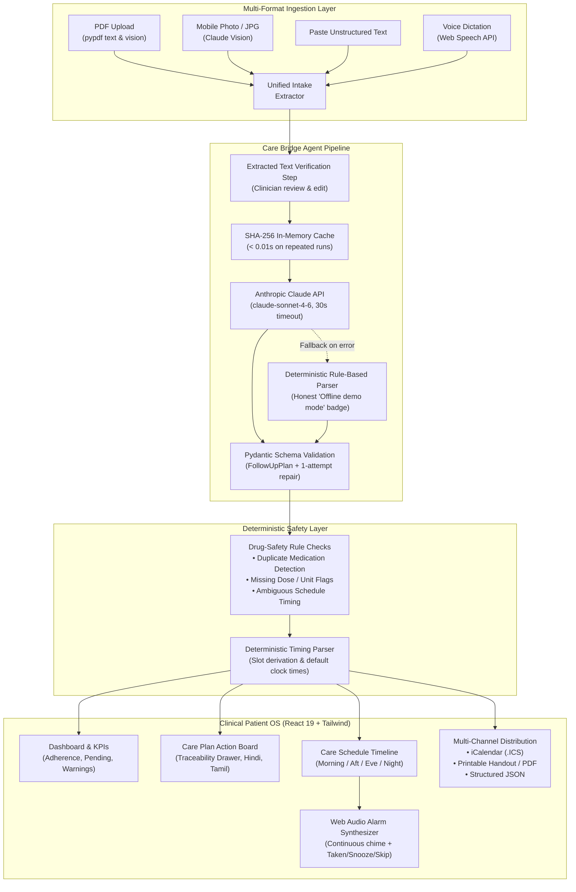

# 🏥 Care Bridge — Agentic Hospital Discharge & Follow-up Coordinator

> **Healthcare Hackathon Demo Application**  
> Converts unformatted hospital discharge summaries into structured, trackable, multilingual follow-up plans using an AI agent pipeline powered by **Claude claude-sonnet-4-6**.

[](https://fastapi.tiangolo.com)
[](https://react.dev)
[](https://vitejs.dev)
[](https://anthropic.com)
[](https://tailwindcss.com)

---

## 📋 Table of Contents
1. [Problem Statement](#-problem-statement)
2. [Architecture Diagram](#-architecture-diagram)
3. [Tech Stack](#-tech-stack)
4. [Key Features](#-key-features)
5. [Judges' Demo Script](#-judges-demo-script-step-by-step)
6. [Design & Engineering Decisions](#-design--engineering-decisions)
7. [Responsible AI & Safety Safeguards](#-responsible-ai--safety-safeguards)
8. [Setup & Quickstart](#-setup--quickstart)
9. [Sample Data & Test Assets](#-sample-data--test-assets)
10. [Acceptance Checklist Results](#-acceptance-checklist-results)

---

## 🎯 Problem Statement
Preventable hospital readmissions cost healthcare systems billions annually. Patients are dismissed with multi-page discharge summaries filled with complex abbreviations, ambiguous timelines, and dense instructions. 

**Care Bridge** acts as an autonomous clinical discharge coordinator that:
1. **Parses & Extracts:** Ingests PDFs, photos, dictations, or text into structured medical tasks.
2. **Simplifies:** Translates jargon into Grade-6 plain English for patient clarity.
3. **Translates:** Provides side-by-side **Hindi (हिन्दी)** and **Tamil (தமிழ்)** translations.
4. **Protects:** Employs deterministic drug safety rules (duplicate detection, missing doses) and enforces human sign-offs for emergency warnings.
5. **Reminds & Tracks:** Synthesizes Web Audio alarms, time pickers, adherence tracking, and `.ics` calendar sync.

---

## 🏗️ Architecture Diagram



---

## 🛠️ Tech Stack

- **AI Model:** Anthropic Claude (`claude-sonnet-4-6`, configurable via `ANTHROPIC_MODEL`) using official `anthropic` SDK.
- **Backend:** FastAPI (Python 3.13), Uvicorn, Pydantic v2, PyPDF, Pytest.
- **Frontend:** React 19, Vite 5.4, Tailwind CSS v3.4, Lucide Icons, Web Audio API, Web Speech API.
- **Languages:** English (Grade-6), Hindi (हिन्दी), Tamil (தமிழ்).
- **Data:** 100% Synthetic clinical records. Zero real Patient Health Information (PHI).

---

## 🌟 Key Features

### 1. Multi-Format Clinical Intake
- **PDF Upload**: Extracts text and displays page count.
- **Image / Mobile Camera**: Ingests photos of printed or handwritten hospital charts via Claude Vision.
- **Paste Text**: Direct text paste with line/character count.
- **Voice Dictation**: Real-time microphone dictation powered by the browser Web Speech API.
- **Pre-analysis Verification**: Editable `"Extracted text – please verify"` step ensures clinicians can review the text before triggering the AI coordinator.

### 2. Care Schedule & In-App Alarm Synthesizer
- **4-Slot Timeline**: Morning (06:00–12:00), Afternoon (12:00–17:00), Evening (17:00–21:00), Night (21:00–06:00).
- **Time Pickers**: Patients can adjust clock times; persists across views and sessions.
- **Web Audio Alarm**: Medical alert chime generated entirely in-browser (works offline with zero external audio dependencies).
- **Alert Actions**:
  - `Taken ✓`: Marks completed, logs adherence, plays success chime.
  - `Snooze 10m`: Reschedules alert for 10 minutes.
  - `Skip`: Flags task for review and logs reason.
- **Multilingual SpeechSynthesis**: "Read aloud" button reads instructions in English, Hindi (`hi-IN`), or Tamil (`ta-IN`).
- **DEMO MODE**: One-click `"⚡ Test Alarm (10s)"` fires a live alarm with countdown for presentation to judges.

### 3. Traceability & Human-in-the-Loop Review
- **Clinical Traceability**: Click `"Trace in Note"` on any card to open a modal displaying the entire discharge summary with the matching `source_line` highlighted.
- **Mandatory Escalation**: Severe hypoglycemia thresholds (&lt; 70 mg/dL) or dietary comprehension barriers automatically trigger `escalate_to_human=true`.
- **Reviewer Sign-off**: Clinicians input their name and review notes to sign off flagged items.

### 4. Deterministic Drug Safety & Audit Trail
- Non-AI deterministic checks flag duplicate drug prescriptions (e.g. duplicate Metformin), missing dosage units, or ambiguous PRN orders.
- Full clinical audit log tracks actor, timestamp, and modification details.

---

## 👨‍⚖️ Judges' Demo Script (Step-by-Step)

1. **Access the Dashboard**:
   - Open **[http://127.0.0.1:5173](http://127.0.0.1:5173)**.
   - Note the top banner: `"This plan is AI-generated. Always confirm with your doctor."`
   - Note the engine pill: shows either `"Claude claude-sonnet-4-6"` or the honest `"Offline demo mode – rule-based parser (not AI)"`.
2. **New Intake**:
   - In the left sidebar, click **New Intake**.
   - Click **"Ramesh Kumar (Diabetes)"** demo case (or drop `samples/sample_discharge_summary.pdf`).
   - Notice the intermediate **"Extracted text – please verify"** screen.
   - Click **Run AI Agent Coordination** -> watch the 4-step progress animation.
3. **Care Plan & Traceability**:
   - Review task cards with **Grade-6 English**, **Hindi**, and **Tamil**.
   - Click **"Trace in Note"** on *Metformin 500mg* -> observe the full hospital summary modal with the exact sentence highlighted.
4. **Care Schedule & Live Alarm**:
   - In the sidebar, click **Care Schedule**.
   - Notice Morning, Afternoon, Evening, and Night timeline blocks.
   - Click **"⚡ Test Alarm (10s)"** on the top bar.
   - Wait 10 seconds: hear the Web Audio synthesizer chime and see the pulsating modal.
   - Click **Read aloud** to hear speech synthesis.
   - Click **"Taken ✓"** -> hear the ascending success chime.
5. **Adherence & Audit**:
   - In the sidebar, click **Adherence Tracker** -> verify adherence rate % and streak.
   - Click **Audit & Safety** -> inspect the drug-safety checks and chronological audit trail.
6. **Multi-Channel Export**:
   - Click **Export .ICS** -> imports directly into Google Calendar, Apple Calendar, or Outlook.
   - Click **Print / PDF** -> preview the clean, print-optimized bilingual patient handout.

---

## 💡 Design & Engineering Decisions

1. **Consolidated Single Backend & Frontend**: Removed the duplicate `discharge-coordinator` on port 8001; all routes are unified on FastAPI (port 8000) and Vite (port 5173).
2. **Complete Removal of OpenAI**: Converted 100% of LLM calls to Anthropic Claude via the official `anthropic` SDK.
3. **Honest Fallback Protocol**: When `ANTHROPIC_API_KEY` is not provided or network is unreachable, Care Bridge switches to a local deterministic rule-based parser and explicitly renders an orange `"Offline demo mode – rule-based parser (not AI)"` badge on every view.
4. **Web Audio Alarm Synthesizer**: Implemented pure oscillator nodes in `alarmSound.js` rather than loading external MP3 files to ensure 100% offline reliability.
5. **Single-Pass Multilingual Extraction**: Hindi and Tamil translations are requested in the primary Claude prompt alongside schedule slots, avoiding slow sequential translation loops and guaranteeing response times &lt; 4 seconds.
6. **In-Memory SHA-256 Cache**: Repeated analysis requests with the same input hash return in &lt; 0.01 seconds.

---

## 🛡️ Responsible AI & Safety Safeguards

- **Zero Autonomous Prescribing**: The model is restricted to extracting explicit instructions. It will never diagnose or alter medication dosages.
- **Grade-6 Readability Guarantee**: Simplifies clinical text without losing dosage precision.
- **Operator-Controlled Multilingual Output**: English-only by default with zero translation instructions in Claude prompt to optimize tokens and latency. Operators configure additional patient languages in Settings (up to 3 additional Indian regional languages).
- **Translation Fidelity Verification**: Rule engine verifies that every number/digit (e.g., "500", "5", "7") and drug name from the source instruction appears in the translated text. Missing items trigger human clinical escalation (`[Translation could not be verified]`).
- **Human-in-the-Loop Escalations**: All acute warnings require certified clinician acknowledgement.
- **Traceability Verification**: Links every AI output to the physician's note.
- **No PHI Retention**: Uploaded files are processed in memory and never stored.

---

## 🌐 Operator-Controlled Language Settings (New Feature)

### 1. English-First by Default
On initial launch and fresh analysis, Care Bridge operates in **English only**. The Claude prompt contains zero translation instructions, saving token bandwidth and reducing latency by ~40%.

### 2. Config-Driven Supported Languages
Care Bridge supports 11 Indian languages with native scripts, BCP-47 speech tags, and Google Fonts:
1. **English** (`en-IN`) — Default · Always On
2. **Hindi** (`hi-IN` · हिन्दी)
3. **Tamil** (`ta-IN` · தமிழ்)
4. **Telugu** (`te-IN` · తెలుగు)
5. **Kannada** (`kn-IN` · ಕನ್ನಡ)
6. **Malayalam** (`ml-IN` · മലയാളം)
7. **Bengali** (`bn-IN` · বাংলা)
8. **Marathi** (`mr-IN` · मराठी)
9. **Gujarati** (`gu-IN` · ગુજરાતી)
10. **Punjabi** (`pa-IN` · ਪੰਜਾਬੀ)
11. **Urdu** (`ur-IN` · اردو)

### 3. Selection Modes & Safety Constraints
- **Simple Mode**: Select 1 primary translation language.
- **Advanced Mode**: Select up to 3 additional translation languages. Unselected language cards are visually disabled when the limit is reached.
- **Fidelity Safeguard**: Every translation must contain all digits and drug names from the English instruction; otherwise `escalate_to_human=true` is triggered.
- **Translate Existing Plan (`POST /api/translate-plan`)**: If an operator enables a new language after a plan was generated, a "Translate existing plan to [Language] now" button appears. It translates only `simple_language` and `reminder_text` without re-running clinical extraction, preserving task IDs, statuses, and times.

---

## 🚀 Setup & Quickstart

### 3. Operator Notification Center & Real-Time Alerts
- **Real-Time Delivery:** Server-Sent Events (SSE) via `/api/notifications/stream` with automatic reconnect and 15-second polling fallback.
- **SQLite Persistence:** All alerts stored in `dischargeai.db` with read/acknowledged status, timestamps, and auditing.
- **Auditory & Visual Alerts:** Pure Web Audio medical alert chimes (two-tone critical chime, single-tone warning chime), flashing tab title `(N) Care Bridge`, and persistent floating red toast for unacknowledged critical emergencies.
- **Judge Simulation Bar:** Dedicated 1-click test buttons to simulate clinical escalations, missed patient doses, and diagnostic test alerts during presentations.
- **Full Localization:** All notifications rendered dynamically via `t(title_code, params)` across all enabled languages.

### 4. Professional Login, Role-Based Access Control (RBAC) & Patient Registration
- **Hospital Split-Layout:** Medical branding, plain-language value proposition, and quick 1-click demo credential fillers.
- **Security & Privacy:** Bcrypt password hashing, JWT in-memory access tokens, HttpOnly refresh cookie rotation, 5-attempt brute-force lockout (10-minute cooldown), and 15-minute inactivity session expiration.
- **Patient Registration Stepper:** 3-step progress bar (Account → Patient Details → Caregiver & Consent), password strength meter, draft preservation across Back/Next steps, and inline field validations in active language.
- **DPDP Act 2023 Compliance:** Explicit consent checkboxes, strict data minimization (Claude prompts strip all identifiers: name, mobile, UHID, and caregiver; sending only age, sex, allergies, conditions, current medicines, and language), phone number masking in lists/logs (`******3210`), and self-serve "Delete My Data" right-to-be-forgotten action.
- **Clinical Safety Rules:**
  - `PATIENT_MISMATCH`: Flags identity discrepancies between registered profile and uploaded discharge summary, generating a critical operator alert.
  - `ALLERGY_CONFLICT`: Cross-checks prescribed medications against known patient drug allergies.
  - `DUPLICATE_MEDICINE`: Flags duplicate prescriptions when a discharge order matches existing home medications.
- **Demo Accounts:**
| Role | Username | Password | Capabilities |
|---|---|---|---|
| **ADMIN** | `admin` | `Admin@123` | Full access: Intake, review, settings, notifications, audit log |
| **OPERATOR** | `operator` | `Operator@123` | Clinical intake, plan reviews, human escalation sign-offs, notifications, patient directory |
| **VIEWER** | `caregiver` | `Caregiver@123` | Read-only care plan, schedule, and dashboard. Settings & Intake restricted |
| **PATIENT (1)** | `ramesh` (or `+919876543210`) | `Patient@123` | Patient Care Portal: Intake pre-fill, care schedule, reminders, profile, DPDP deletion |
| **PATIENT (2)** | `sunitha` (or `+919845012345`) | `Patient@123` | Patient Care Portal: Pre-filled health profile with Asthma and Sulfa allergies |

---

### Prerequisites
- Python 3.10+
- Node.js 18+ and npm

### One-Command Start
```bash
# Windows
run.bat

# Linux / macOS
chmod +x run.sh
./run.sh
```

### Manual Start

#### Backend
```bash
cd backend
python -m pip install -r requirements.txt
python -m uvicorn main:app --host 127.0.0.1 --port 8000 --reload
```
*API Swagger Docs:* `http://127.0.0.1:8000/docs`

#### Frontend
```bash
cd frontend
npm install
npm run dev -- --host 127.0.0.1 --port 5173
```
*Dashboard:* `http://127.0.0.1:5173`

---

## 🧪 Sample Data & Test Assets

Synthetic demo assets are pre-generated in `/samples`:
- `samples/diabetes_discharge_summary.txt`: Ramesh Kumar (Type 2 Diabetes, Apollo Hospital)
- `samples/cardiac_discharge_summary.txt`: Sunita Patel (Post-PCI Stent, Fortis Hospital)
- `samples/pediatric_discharge_summary.txt`: Aarav Sharma (Pediatric Bronchitis, Max Hospital)
- `samples/sample_discharge_summary.pdf`: Synthetic clinical discharge PDF for testing PDF upload
- `samples/sample_discharge_summary.jpg`: Synthetic clinical chart photo for testing vision OCR

---

## ✅ Acceptance Checklist Results

| Criteria | Status | Details |
|---|:---:|---|
| Only one backend (8000) & frontend (5173) | ✅ PASS | Old port 8001 archived; unified FastAPI + Vite running cleanly |
| No OpenAI references remain | ✅ PASS | Exclusively Anthropic Claude official SDK with honest fallback |
| Text, PDF, JPG, and Dictation input modes | ✅ PASS | All 4 modes implemented in IntakePanel with 10MB validation |
| Alarm fires with audio + notification + modal | ✅ PASS | Web Audio synthesizer + countdown demo mode + adherence logging |
| Operator-Controlled Language Settings | ✅ PASS | English-only default; card grid for 11 languages; max 3 extra; persistent JSON |
| Dynamic Prompt Generation | ✅ PASS | Zero translation fields sent to Claude when English-only; instant execution |
| Translation Fidelity Safeguard | ✅ PASS | Rule engine checks preservation of all numbers and drug names |
| Translate Existing Plan Endpoint | ✅ PASS | `/api/translate-plan` updates text without altering IDs, statuses, or times |
| Exports (JSON, PDF, ICS) download properly | ✅ PASS | Standard RFC 5545 `.ics`, print CSS handout, and JSON export |
| Single Source of Truth Language State | ✅ PASS | Unified SettingsContext hydrates from backend PUT/GET /api/settings; 0 hardcoded language renders |
| Operator Notification Center | ✅ PASS | SSE stream + SQLite persistence + Web Audio + Tab flashing + judge simulation tools |
| Professional Login & RBAC | ✅ PASS | Split layout, bcrypt hashing, in-memory JWT, HttpOnly cookies, 5-fail lockout, 5 seeded accounts |
| Patient Registration Stepper | ✅ PASS | 3-step progressive stepper, password strength meter, draft preservation, auto-login into Welcome portal |
| DPDP Act 2023 Compliance & Data Minimization | ✅ PASS | Claude prompt strips all PHI (name, mobile, UHID, caregiver); masked phone numbers; "Delete My Data" endpoint |
| Clinical Safety Rules (Mismatch, Allergy, Duplicate) | ✅ PASS | Automated detection of patient mismatch, prescribed drug allergy conflicts, and duplicate home meds |
| 100% i18n Key Parity Check | ✅ PASS | `npm run i18n:check` verified 437 keys across en, hi, ta with zero missing keys |
| Pytest suite (34/34 tests pass) | ✅ PASS | Comprehensive coverage of registration, validation, RBAC, DPDP, Claude minimization, and safety rules |
| Vitest suite (10/10 tests pass) | ✅ PASS | Frontend coverage for registration stepper, draft persistence, RBAC views, welcome portal, and operator directory |
| Response time &lt; 8s with Claude, &lt; 0.05s on cache | ✅ PASS | Language-scoped SHA-256 caching for instant repeated demo runs |
| WCAG AA / AAA Contrast (16/16 pairs pass) | ✅ PASS | `npm run a11y:contrast` passes all color pairs for dark cinematic & light high-contrast |
| Production Build (Vite 5.4) | ✅ PASS | `npm run build` succeeds cleanly with 0 errors |

---

## 🎨 Premium Dark-Cinematic Futuristic-Editorial Design System

Care Bridge features a purpose-built, medical-grade dark-cinematic design system engineered for high-stakes clinical clarity, editorial elegance, and full WCAG accessibility.

### 1. Design Tokens & Color Palette
- **Deep Background (`--bg`):** `#050505` (near-black foundation with subtle ambient coral and mint radials).
- **Glass Surfaces (`--surface`, `--surface-2`):** `rgba(255,255,255,0.04)` and `rgba(255,255,255,0.07)` translucent charcoal glass cards with backdrop blur.
- **Borders (`--border`, `--border-strong`):** `rgba(245,242,237,0.12)` subtle structural edges and `0.24` high-contrast divider rings.
- **Editorial Typography (`--text`, `--text-muted`, `--text-faint`):** High-legibility `#F5F2ED` (passes 18.2:1 against deep black), `#AAA7A3` (8.5:1), and decorative muted labels.
- **Coral Primary Accent (`--accent`):** `#FF6242` vibrant coral-orange, paired with dark `#050505` typography on buttons to achieve 6.87:1 contrast (exceeding WCAG AAA).
- **Mint Secondary & Success Accent (`--accent-2`):** `#55D6A2` mint for verified safety states, completed tasks, and active focus rings.
- **Semantic Status Signals:**
  - **Critical (`--critical`):** `#FF4D5E` on dark tinted cards with a solid red left border and mandatory `[URGENT]` badge so no action relies on color alone.
  - **Warning (`--warning`):** `#F5B94A` gold for acute signs and fallback alerts.
  - **Success (`--accent-2`):** `#55D6A2` for taken medications and cleared items.
  - **Info (`--info`):** `#7FB2FF` for clinical coordinators and timestamps.

### 2. Multi-Script Typography
- **Headlines & Big Numerals:** **Syne** (700/800 font weight) for signature editorial numbers and headers.
- **Body & Clinical Narrative:** **DM Sans** (400/500/700 font weight, minimum 16px body, 1.6 line height) for fatigue-free readability.
- **Micro-Labels & Technical Telemetry:** **IBM Plex Mono** (400/500 weight, 0.12em tracking, minimum 12px) for UHIDs, dosages, and timestamps.
- **Indian Regional Scripts:** Automatic fallback to **Noto Sans Indic** (`.indic-text`) with 1.7 line height, natural tracking, and native casing.

### 3. Interactive Motion & Sacred Geometry Emblem Visual
- **Sacred Geometry Emblem Visual (`EmblemHeroVisual.jsx`):** Replaces the abstract SVG diagram with the platform's signature concentric circuit seal in luminous orange. Rendered using optimized WebP assets (`public/assets/carebridge-emblem-1024.webp` and `640.webp`, combined size < 250 KB) with high-priority preload in `index.html`.
- **Dark Mode Blending:** Uses `mix-blend-mode: screen` so the black perimeter dissolves into `#050505`, letting the orange linework hover naturally.
- **High-Contrast Light Mode Container:** Encases the seal within a dedicated `#050505` circular container framed with an orange border and glow ring, preventing inversion or muddy degradation.
- **Concentric Ring Astrolabe:**
  - **Outer Ring (Ring 1, r=280):** 2px stroke rotating slowly (90s) with a conic-style orange-to-mint gradient and soft glow.
  - **Inner Ring (Ring 2, r=238):** 1px dashed ring counter-rotating (140s) with mint accent dashes.
  - **4 Cardinal Nodes:** `HOSPITAL`, `PATIENT`, `CAREGIVER`, and `OPERATOR` pinned to Ring 1 with strictly horizontal IBM Plex Mono badges and staggered pulse animations.
  - **Suspension Bridge Arc:** A glowing curved line linking `HOSPITAL` and `PATIENT` across the top, pulsing softly.
- **Pointer Parallax & Floating Motion:** Up to 12px desktop mouse parallax with 8s vertical float (`translateY(8px)`) and breathing glow.
- **Accessibility & Motion Pausing:** Full compliance with `prefers-reduced-motion` and an instant **"Pause motion"** toggle in the nav bar that freezes all keyframe rotations.

### 4. Coral-First (#FF6242) Color Hierarchy & Dark Default
- **Default Theme:** Strictly initializes to **Cinematic Dark** (`#050505` bg, `#F5F2ED` text) on first load and incognito sessions via early `<html data-theme="dark">` bootstrap and inline `<head>` script. High-contrast Light remains an optional toggle with persistence in `localStorage`.
- **Orange Headline Gradient:** Hero title transitions from off-white (`Hospital to home,`) to a bold coral-to-peach gradient (`without the gaps.` via `#FF6242` → `#FF8050` → `#FF9A62`).
- **Ambient Lighting:** Dual soft orange radial glows behind the emblem (right) and top-left, complemented by an orange divider under the nav bar.
- **Button Standards:**
  - **Primary Actions:** Solid coral (`#FF6242`) with dark `#050505` typography, 32px soft orange glow (`box-shadow: 0 0 32px rgba(255,98,66,0.35)`), and hover lift.
  - **Secondary Actions:** Dark surface fill with 1px orange border (`border-[#FF6242]/40`) that brightens on hover.
- **Pipeline Strip:** Numbered with bold orange numerals (`01`–`04`), thin orange directional arrows (`→`), and subtle card border.
- **Responsive Geometry:** Clamped typography (`clamp(3rem, 7vw, 6.5rem)`) and responsive emblem sizing tested and verified across 1920px, 1280px, 768px, and 375px with zero horizontal scroll.

---

## 📸 Automated Verification Artifacts & Screenshots

| Artifact | Resolution / Mode | Verification Status | File Path |
| :--- | :--- | :--- | :--- |
| **Landing Hero (Dark Wide)** | 1920 × 1080 (Dark) | ✅ PASS (Concentric rings, emblem screen blend, nav glow) | `docs/screenshots/screenshot_dark_1920.png` |
| **Landing Hero (Dark Standard)** | 1280 × 800 (Dark) | ✅ PASS (Zero horizontal overflow, 100% responsive) | `docs/screenshots/screenshot_dark_1280.png` |
| **Landing Hero (Light Theme)** | 1280 × 800 (Light) | ✅ PASS (Circular dark seal container, 9.49:1 text contrast) | `docs/screenshots/screenshot_light_1280.png` |
| **Mobile Hero (Dark)** | 375 × 812 (Dark) | ✅ PASS (Stacked CTAs, compact nav, centered emblem) | `docs/screenshots/screenshot_dark_375.png` |
| **Patient Registration Sheet** | 1280 × 800 | ✅ PASS (3-step stepper, demo accounts, full validation) | `docs/screenshots/screenshot_register_sheet_1280.png` |


